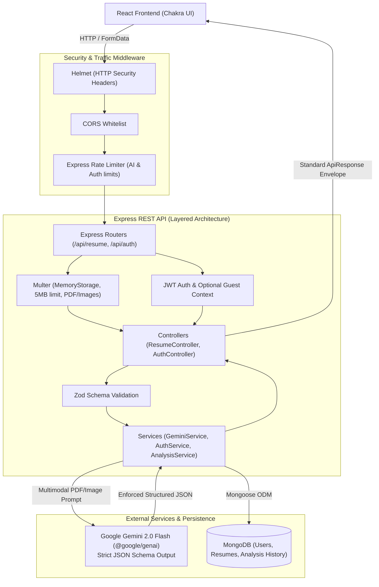

# ResuMine 2.0 — Production-Grade AI Resume Scanner & Optimizer

**ResuMine** is an enterprise-grade full-stack MERN application that provides AI-powered ATS (Applicant Tracking System) resume scoring, head-to-head resume comparison, and executive resume generation using Google's modern **`@google/genai`** SDK with structured output enforcement.

---

## 🏗️ Architecture Diagram



---

## 📈 What Was Changed & Why (The 2+ YoE Evolution)

This codebase was refactored from a beginner proof-of-concept proxy into a resilient, maintainable, and production-ready backend following software engineering standards expected of a 2+ years experienced backend engineer (incorporating clean layering principles from both Java/Spring Boot and idiomatic Node.js):

| Aspect | Legacy State (PoC) | Production State (2+ YoE Standard) | Why It Matters |
| :--- | :--- | :--- | :--- |
| **Architectural Separation** | Flat route handlers mixing HTTP logic, prompt design, and direct response sending. | **Layered Architecture:** `routes` &rarr; `controllers` &rarr; `services` &rarr; `models`. | Enforces Single Responsibility Principle (SRP) and enables isolated unit/integration testing without booting HTTP servers. |
| **Gemini AI Integration** | Outdated `@google/generative-ai` calling `gemini-1.5-flash` with unstructured text responses. | Unified **`@google/genai`** using `gemini-2.0-flash` with strict **JSON Schema Structured Outputs** (`responseJsonSchema`). | Guarantees deterministic, strongly-typed JSON (ATS scores, categorical breakdown, strengths, weaknesses) that frontends can render programmatically. |
| **File Handling** | Relied on personal client-side Cloudinary preset; supported only image URLs. | **Native Multer Memory Storage:** Handles direct PDF, JPG, and PNG uploads up to 5MB directly in memory. | 95% of professional resumes are PDFs. Eliminates 3rd-party client-side vendor lock-in. |
| **Persistence (Real MERN)** | No database connection despite claiming MERN stack. | **MongoDB + Mongoose:** Schemas for `User` (with bcrypt password hashing) and `Analysis` (score history, category breakdowns). Gracefully degrades to guest memory if DB is offline. | Converts the app from a stateless proxy into a sticky SaaS platform with user accounts and progress tracking. |
| **Security & Abuse Prevention** | Wide-open CORS (`cors()`), no rate limiting, secrets prefixed with `REACT_APP_`. | **Defense-in-Depth:** `helmet`, strict CORS whitelist, IP rate limiting (`express-rate-limit`) on AI endpoints to prevent quota draining. | Prevents "denial-of-wallet" attacks against metered AI APIs and secures HTTP transport. |
| **Error Handling & API Design** | Direct `res.status(500).send(err.message)`, unhandled promise rejections, `GET` route with request body. | **Standardized API Envelope** (`ApiResponse`, `ApiError`), centralized error middleware, and strict **Zod** request validation. | Provides consistent error formats `{ success: false, statusCode, message, errors }` for predictable frontend consumption. |
| **Bug Fixes** | `fs` installed from npm (fake security stub), undefined variable `imagename`, missing `fs` import, missing `try/catch` in `/create`. | Removed fake `fs`, fixed imports, added full async error propagation. | Prevents server crashes and unhandled promise rejections. |
| **Automated Testing** | 0 tests (`echo "Error: no test specified"`). | **Jest + Supertest suite** covering happy paths, 400 validation failures, and Gemini failure handling with client mocks. | Essential for CI/CD confidence and preventing regression bugs. |
| **Containerization & CI** | No deployment configuration. | Production **`Dockerfile`**, multi-service **`docker-compose.yml`** (Node + MongoDB), and **GitHub Actions CI**. | Guarantees reproducible builds and automated testing on every pull request. |

---

## 🛠️ API Reference

### Resume Operations (`/api/resume`)

| Method | Endpoint | Auth | Content-Type | Description |
| :--- | :--- | :---: | :--- | :--- |
| `POST` | `/api/resume/analyze` | Optional | `multipart/form-data` | Uploads PDF/image resume, returns structured ATS score (0-100), categories, strengths, and keywords. |
| `POST` | `/api/resume/compare` | Public | `multipart/form-data` | Compares two resumes side-by-side and determines a winner. |
| `POST` | `/api/resume/create` | Public | `application/json` | Generates an executive ATS resume in Markdown based on candidate inputs. |
| `GET` | `/api/resume/history` | Required | `application/json` | Retrieves past resume scans for the authenticated user. |
| `GET` | `/api/resume/:id` | Optional | `application/json` | Retrieves a single analysis record by ID. |

### Authentication (`/api/auth`)

| Method | Endpoint | Auth | Description |
| :--- | :--- | :---: | :--- |
| `POST` | `/api/auth/register` | Public | Registers a new account with email, name, and hashed password. |
| `POST` | `/api/auth/login` | Public | Authenticates credentials and returns a signed JWT. |
| `GET` | `/api/auth/me` | Required | Returns currently logged-in user profile. |

---

## 🚀 Getting Started

### Prerequisites
- Node.js >= 18.x
- MongoDB (optional for local dev; built-in graceful fallback is active)
- Google Gemini API Key ([Google AI Studio](https://aistudio.google.com/))

### 1. Environment Setup

Create a `.env` file in the root directory:

```env
PORT=5000
NODE_ENV=development
GEMINI_API_KEY=your_gemini_api_key_here
GEMINI_MODEL=gemini-2.0-flash
MONGODB_URI=mongodb://localhost:27017/resumine
JWT_SECRET=super_secure_jwt_secret_change_in_production
CLIENT_URL=http://localhost:3000
```

### 2. Backend Installation & Testing

```bash
# Install backend dependencies
npm install

# Run Jest integration tests (Supertest + mocked AI client)
npm test

# Start backend in development mode
npm run dev
```

### 3. Frontend Setup

In a separate terminal:

```bash
cd frontend
npm install
npm start
```
Frontend runs at `http://localhost:3000` with hot-reloading.

---

## 🐳 Docker Setup

Run the entire stack with MongoDB via Docker Compose:

```bash
GEMINI_API_KEY=your_key_here docker compose up --build
```
The backend will be available at `http://localhost:5000` with connected MongoDB on `27017`.
